<a target="_blank" href="https://www.microchip.com/" id="top-of-page">
   <picture>
      <source media="(prefers-color-scheme: light)" srcset="images/mchp_logo_light.png" width="350">
      <source media="(prefers-color-scheme: dark)" srcset="images/mchp_logo_dark.png" width="350">
      
   </picture>
</a>

# Intelligent Object Sorting Conveyor System - Host Node

## Introduction
This application demonstrates the Host node as the central controller in an intelligent object sorting conveyor system. Built around the PIC32CZ CA70 Curiosity Ultra Development Board, the Host node captures images using a camera, performs machine learning inference to classify objects (circle, triangle, and square), controls the conveyor and dispenser motors, and coordinates with Client nodes over the 10BASE-T1S single-pair Ethernet network to operate sorting gates.

<p align="left">
  <b>Figure 1.</b> System Overview<br>
  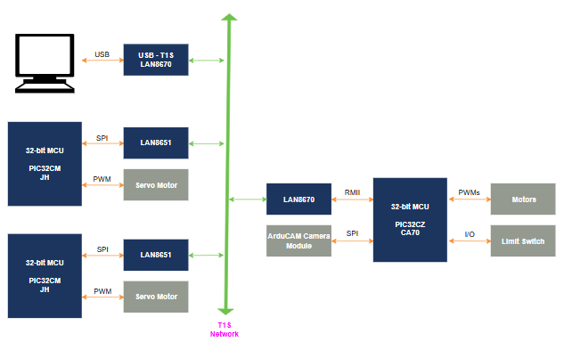
</p>

## Modules and Technology Used

### Inference Firmware

- Peripheral modules:
    - PIO
    - SYSTICK
    - UART1
    - SPI0
    - TC0
    - PWM0
    - EFC
    - NVIC
    - MPU
    - CLK
    - XDMAC

- Drivers:
    - SPI
    - GMAC
    - MIIM
    - ETHPHY
    - LAN867x

- System services:
    - Time
    - CONSOLE
    - DEBUG
    - COMMAND
    - CACHE
    - RESET
    - PORTS
    - DMA
    - wolfCrypt Library

- Middleware libraries:
    - Harmony Core
    - Cryptographic Library
    - TFLite-Micro

- TCP/IP Stack:
     - Application Layer
          - DNS Client
          - DHCP Client
     - Basic Configuration
          - TCPIP CMD
          - TCPIP Core
     - Data Link Layer
          - NETCONFIG
     - Network Layer
          - ARP
          - ICMPV4
          - IPV4
     - Transport Layer
          - TCP
          - UDP

<p align="left">
  <b>Figure 2.</b> Project Graph<br>
  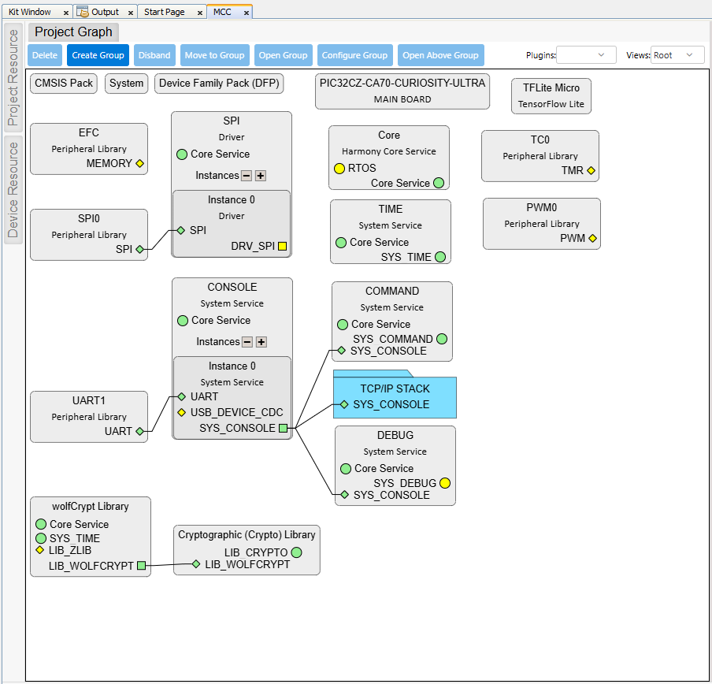
</p>

### Training Firmware

- Peripheral modules:
    - PIO
    - SYSTICK
    - UART1
    - SPI0
    - TC0
    - PWM0
    - EFC
    - NVIC
    - CLK
    - XDMAC
    - RTT

- Drivers:
    - SPI

- System services:
    - Time
    - CONSOLE
    - DEBUG
    - CACHE
    - RESET
    - PORTS
    - DMA

The training firmware does not include the TCP/IP stack, the GMAC and 10BASE-T1S drivers, TFLite-Micro, or wolfCrypt.

## Related Documentation

- [PIC32CZ2051CA70144 Product Page](https://www.microchip.com/en-us/product/pic32cz2051ca70144)
- [PIC32CZ CA70 Curiosity Ultra Development Board](https://www.microchip.com/en-us/development-tool/ev56t44a)
- [PIC32CZ2051CA70144 Code Examples on Discover](https://mplab-discover.microchip.com/v2?dsl=PIC32CZ2051CA70144)
- [PIC32CZ2051CA70144 Code Examples on GitHub](https://github.com/Microchip-MPLAB-Harmony/reference_apps_pic32cz)

## Software Used

- [MPLAB® X IDE v6.35](http://www.microchip.com/mplab/mplab-x-ide) or newer
- [MPLAB® XC32 Compiler v6.00](http://www.microchip.com/mplab/compilers) or newer
- [MPLAB® Code Configurator (MCC) v5.7.0](https://www.microchip.com/mplab/mplab-code-configurator) or newer
- [Microchip PIC32CZ-CA70_DFP v1.3.62](https://packs.download.microchip.com/) or newer
- CSP v3.25.1
- CORE v3.16.2
- CMSIS_5 v5.9.0
- Net v3.14.5
- Net_10Base_T1S v1.4.3
- wolfssl v5.4.0
- Crypto v3.8.2
- TFLite-Micro v1.0.0
- TFLite-Micro-Apps v1.0.2
- SHD v1.3.0
- MCC Core v5.9.0

> **Note:** The packages listed above are used by the inference firmware. The training firmware uses only PIC32CZ-CA70_DFP, CSP, CORE, CMSIS_5, and SHD.

## Hardware Used

- [PIC32CZ CA70 Curiosity Ultra Development Board](https://www.microchip.com/en-us/development-tool/ev56t44a)
- [EVB-LAN8670-RMII](https://www.microchip.com/en-us/development-tool/ev06p90a)
- [EVB-LAN8670-USB](https://www.microchip.com/en-us/development-tool/ev08l38a)
- [PROTO Click (MIKROE-1507)](https://www.mikroe.com/proto-click)
- [ArduCAM® Camera Module (B0401)](https://www.arducam.com/presale-mega-5mp-color-rolling-shutter-camera-module-with-autofocus-lens-for-any-microcontroller.html)
- [Cytron 3Amp Motor Driver MDD3A (381249)](https://robu.in/product/cytron-3amp-4v-16v-dual-channel-dc-motor-driver-mdd3a/)
- [4ch Level Converter (R183234)](https://robu.in/product/smartelex-logic-level-converter-bi-directional/)
- DC Motor - Two (for conveyor belt and object dispenser)
- 12V DC power supply (for the DC motors)
- 5V DC power supply (for the servo motor)
- TowerPro SG90 servo motor (for object drop mechanism)
- TowerPro MG995 servo motor - Two (for the sorting gates, controlled by the Client nodes)
- Limit Switch (for dispenser home position detection)

## Mechanical Design

The conveyor, sorting gates and object dispenser are built from aluminium extrusion profiles and 3D-printed parts. The step-by-step build guide, with the full hardware list, is in the [Mechanical Assembly Guide](design/README.md).

<p align="left">
  <b>Figure 3.</b> Assembled System (3D View)<br>
  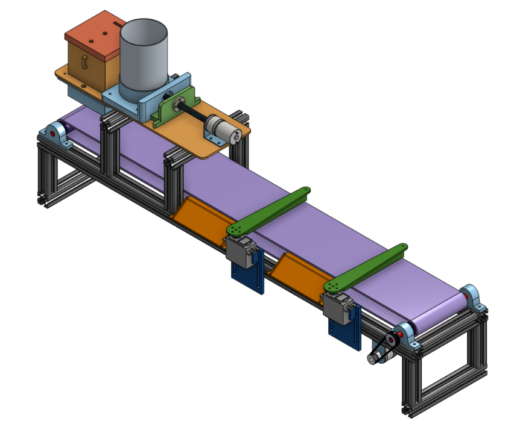
</p>

Build and assemble the conveyor system first, following the [Mechanical Assembly Guide](design/README.md), before wiring the electronics in the Hardware Setup section. The STL files for the 3D-printed parts are in the same folder.

## Software Setup

The GUI and the image viewer are provided as pre-built Windows executables in the `script` folder:

- `object_sorter_gui.exe`: controls and monitors the object sorting system
- `image_viewer.exe`: captures training images from the camera

A Windows® PC is required to run these tools. For the inference demo, a serial terminal application, such as Tera Term or PuTTY, is also needed to view the Host node console output (115200 baud).

## Hardware Modification

- Solder the components on the PROTO Click board™ as shown in the following wiring diagram.
   <p align="left">
     <b>Figure 4.</b> Hardware Modification Wiring Diagram<br>
     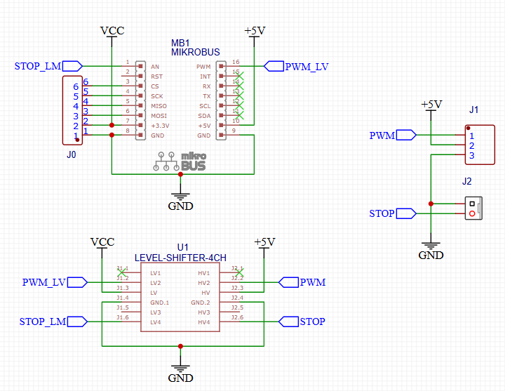
   </p>

## Hardware Setup

1. Install the EVB-LAN8670-RMII board on the PIC32CZ CA70 Curiosity Ultra Development Board as the main controller.
   <p align="left">
     <b>Figure 5.</b> EVB-LAN8670-RMII Board Installation<br>
     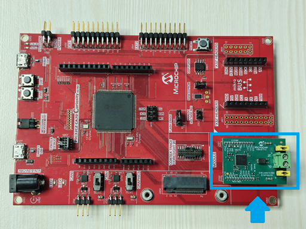
   </p>
  <p></p>

2. Insert the Custom PROTO Click board into the mikroBUS™ connector on the development board.
   <p align="left">
     <b>Figure 6.</b> Custom PROTO Click Board Connection<br>
     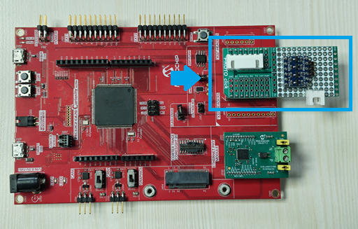
   </p>
  <p></p>

3. Enable the T1S network termination by setting the termination jumpers on the EVB-LAN8670-RMII board as shown in the following image.
   <p align="left">
     <b>Figure 7.</b> T1S Network Termination Configuration<br>
     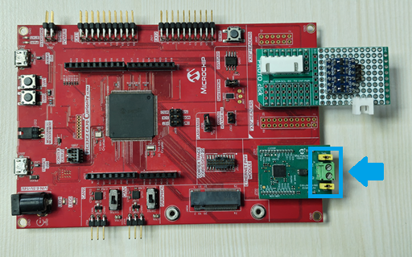
   </p>
  <p></p>

4. Connect the ArduCAM® MEGA camera module to the Custom PROTO Click board of the PIC32CZ CA70 Curiosity Ultra Development Board as shown in the following images.
   <p align="left">
     <b>Figure 8.</b> ArduCAM Camera Module Connection<br>
     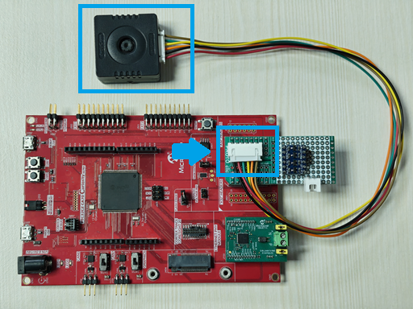
   </p>
   <p align="left">
     <b>Figure 9.</b> ArduCAM Camera Module Wiring<br>
     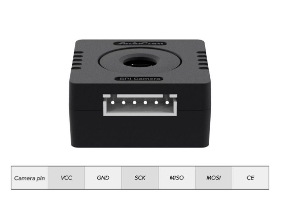
   </p>
  <p></p>

5. Use the PWM connector for the servo motor as shown in the following table.

   <p align="left"><b>Table 1.</b> Servo Motor Pinouts</p>
   <div align="left">

   | Output Pin                  | Servo Motor Pin  |
   |:---------------------------:|:----------------:|
   | PA0 (TC0_TIOA0, PWM output) | PWM (signal)     |
   | VCC                         | VCC              |
   | GND                         | GND              |

   </div>

   > **Note:** This is the drop servo (TowerPro SG90) of the object dispenser. The firmware drives it through the TC0 channel 0 output (TIOA0).

   <p align="left">
     <b>Figure 10.</b> Servo Motor Connection<br>
     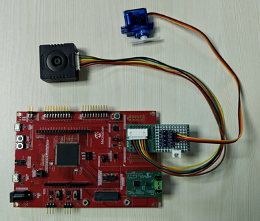
   </p>
  <p></p>

6. Connect the limit switch to the PROTO Click board™ of the PIC32CZ CA70 Curiosity Ultra Development Board as shown in the following image. The limit switch input is pin PC31 (`STOP_LS`) and is active-low: the firmware  interprets a low level as indicating that the dispenser is at the home position.
   <p align="left">
     <b>Figure 11.</b> Limit Switch Connection<br>
     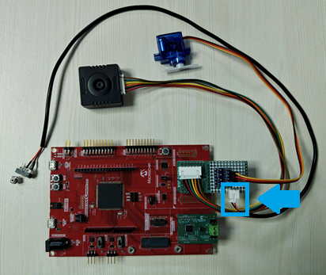
   </p>
  <p></p>

7. Use the Extension 2 pins for the conveyor and dispenser DC motor control as shown in the following table.

   <p align="left"><b>Table 2.</b> DC Motor Driver Pinouts</p>
   <div align="left">

   |   EXT2 Pins    | Motor Driver Pins  | Motor      |
   |:--------------:|:------------------:|:----------:|
   | PIN5 - PD24    | M1A                | Conveyor   |
   | PIN9 - PA02    | M1B                | Conveyor   |
   | PIN7 - PC19    | M2A                | Dispenser  |
   | PIN4 - PC13    | M2B                | Dispenser  |
   | PIN2/19 - GND  | GND                | -          |

   > **Note:** The conveyor motor uses PWM0 channels 0 and 1, and the dispenser motor uses PWM0 channels 2 and 3. Connect the conveyor motor to the M1A/M1B terminals and the dispenser motor to the M2A/M2B terminals. If they are swapped, the two motors swap roles.

   </div>

   <p align="left">
     <b>Figure 12.</b> DC Motor Driver Connection<br>
     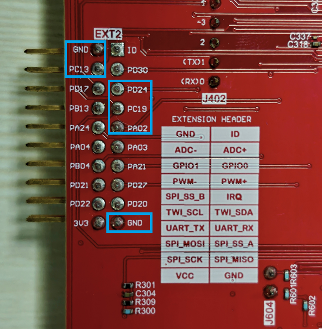
   </p>

   <p align="left">
     <b>Figure 13.</b> DC Motor Wiring<br>
     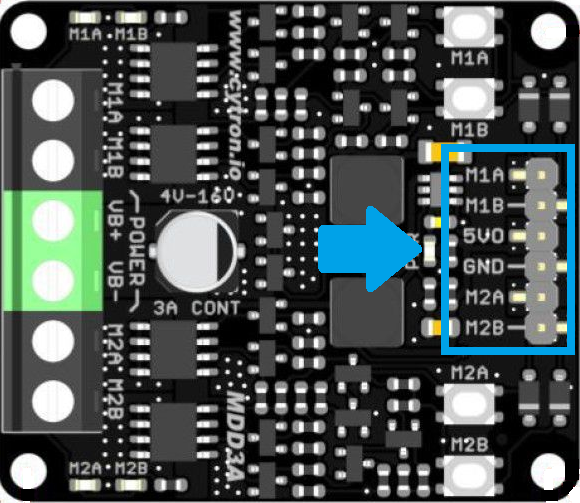
   </p>
  <p></p>

8. Connect the motor power supply to the POWER terminal of the motor driver (VB+ and VB-), and the two DC motors to the M1A/M1B and M2A/M2B terminals.

   > Power supply: Use a 12V supply for the DC motors (motor driver POWER terminal) and a 5V supply for the servo motor.
   <p align="left">
     <b>Figure 14.</b> Motor Driver Power and Motor Terminals<br>
     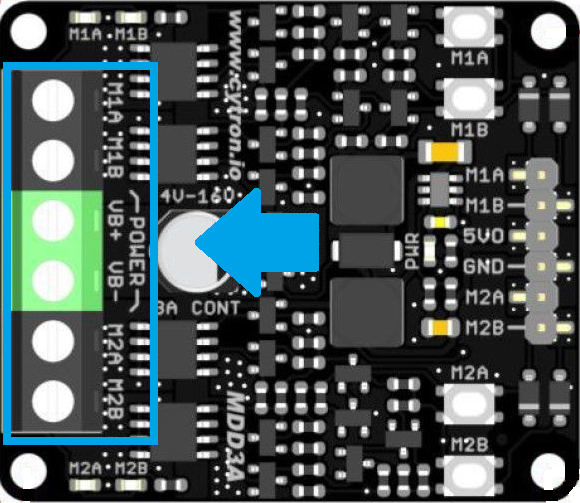
   </p>
  <p></p>

9. Connect the Host node to the T1S network using twisted-pair wiring through the N and P terminals of the EVB-LAN8670-RMII board. The Host must be connected to both Client 0 and Client 1 nodes, and the N and P polarity must be the same on every node.
   <p align="left">
     <b>Figure 15.</b> EVB-LAN8670-RMII T1S Connector (N/P)<br>
     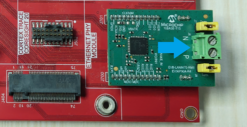
   </p>
   <p align="left">
     <b>Figure 16.</b> EVB-LAN8670-USB T1S Connector (N/P)<br>
     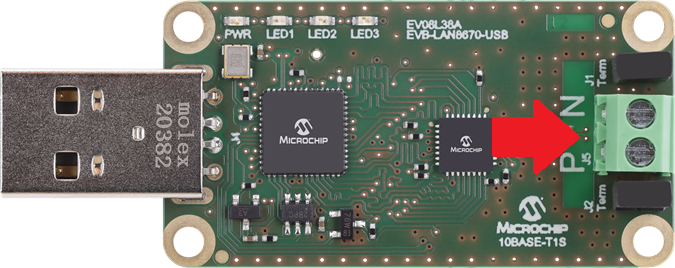
   </p>
  <p></p>

## How to Program the Hex File

The pre-built hex files are available in the following locations:

| Firmware | Hex file |
|----------|----------|
| Training | `firmware/hex/training/pic32czca-object-sorter-host-mplab-mcc.X.production.hex` |
| Inference | `firmware/hex/inference/pic32czca-object-sorter-host-mplab-mcc.X.production.hex` |

Program the hex file that matches the part of the demo being run (training or inference). The pre-built hex file can be programmed by following these steps:

1. Open MPLAB X IDE.
2. Close all existing projects in IDE, if any project is opened.
3. Go to _File>Import>Hex/ELF File_.
4. In the Import Image File window, under Step 1 - Create Prebuilt Project section, click the **Browse** button to select the pre-built hex file.
5. Choose PIC32CZ2051CA70144 under Select Device.
6. Ensure the proper tool is selected under Hardware Tool.
7. Click the **Next** button.
8. In the Import Image File window, under Step 2 - Select Project Name and Folder, select the appropriate project name and folder.
9. Click the **Finish** button.
10. In MPLAB X IDE, click the **Make and Program Device** button to program the device.
11. Program the Client nodes as described in the [Client nodes](#Client-nodes) section, then follow the steps in the Running the Demo section below.

## Building the Firmware From Source

1. Open MPLAB X IDE, then open the project for the required firmware.
   - Inference: `firmware/inference/pic32czca-object-sorter-host-mplab-mcc.X`
   - Training: `firmware/training/pic32czca-object-sorter-host-mplab-mcc.X`
2. Ensure that the tool versions listed in the [Software Used](#software-used) section are installed.
3. Click **Clean and Build**, then **Make and Program Device**.

## Client Nodes

The sorting gates are controlled by two Client nodes (PIC32CM JH01 with LAN8651 10BASE-T1S). Program and wire them from their own projects before running the demo. Use the same steps described in [How to Program the Hex File](#how-to-program-the-hex-file), selecting the PIC32CM JH01 device.

| Node | Project | Pre-Built Hex File | Gate | TCP Port |
|------|---------|--------------------|------|:--------:|
| Client 0 | `pic32cmjh-object-sorter-client0-mplab-mcc` | `hex/pic32cmjh-object-sorter-client0-mplab-mcc.X.production.hex` | Gate 0 (circles) | 9761 |
| Client 1 | `pic32cmjh-object-sorter-client1-mplab-mcc` | `hex/pic32cmjh-object-sorter-client1-mplab-mcc.X.production.hex` | Gate 1 (triangles) | 9762 |

Both clients connect to the Host node at `192.168.100.11`. The hex file paths are relative to the root of each Client project.

## Running the Demo
### Model Training

1. Program the PIC32CZ CA70 Curiosity Ultra Development Board using the training project inside the firmware.

2. Before running the GUI application, ensure the steps in the [_Software Setup_](#software-setup) section have been completed.

3. Run `image_viewer.exe` from the `script` folder.

4. The Image Receiver window opens.
   <p align="left">
     <b>Figure 17.</b> Image Receiver Window<br>
     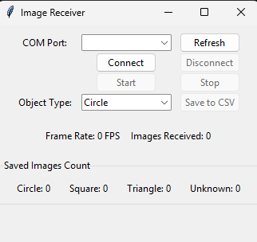
   </p>
  <p></p>

5. Click the **Refresh** button to get all connected COM ports and select the COM port of the PIC32CZ CA70 Curiosity Ultra Development Board.
   <p align="left">
     <b>Figure 18.</b> COM Port Selection<br>
     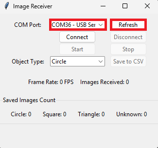
   </p>
  <p></p>

6. Click the **Connect** button to communicate with the selected COM port.
   <p align="left">
     <b>Figure 19.</b> Connect to COM Port<br>
     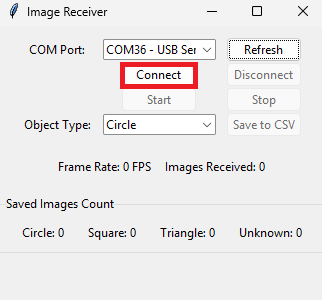
   </p>
  <p></p>

7. Click the **Start** button to receive the captured images from the PIC32CZ CA70 Curiosity Ultra Development Board.
   <p align="left">
     <b>Figure 20.</b> Start Capturing Images<br>
     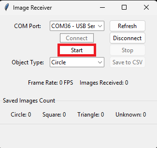
   </p>
   <p align="left">
     <b>Figure 21.</b> Live Image Stream<br>
     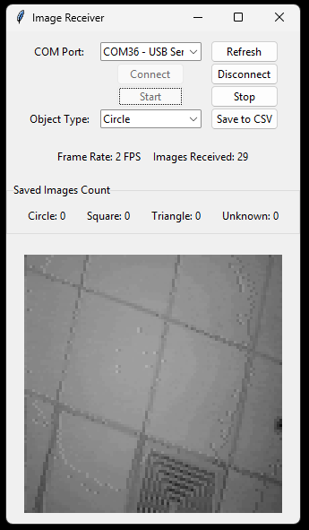
   </p>
  <p></p>

8. Capture the incoming image and store the images using the **Save** button for model training. Use the Drop-Down option to select the object shape.
   <p align="left">
     <b>Figure 22.</b> Save Training Images<br>
     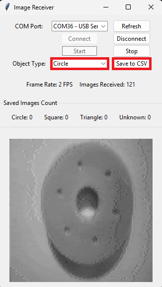
   </p>
  <p></p>


> **Notes:**
> - The training firmware and `image_viewer.exe` only capture and save images, and the model will be trained separately using the saved images. The inference firmware already includes a trained model (`firmware/inference/src/model_data.h`), so the training steps above are only needed to capture a new dataset.
> - Image format: The training firmware streams each 96x96 grayscale image (9216 bytes) over the serial port. `image_viewer.exe` sets up the port directly
> - Output: Saved images are written to CSV files in the `captured_images/` folder next to the tool

### Inference

1. Program the PIC32CZ CA70 Curiosity Ultra Development Board using the inference project inside the firmware.

2. Before running the GUI application, ensure the steps in the [_Software Setup_](#software-setup) section have been completed.

3. Power on the Host node and wait for initialization to complete.

4. On the host PC, open a serial terminal application, such as Tera Term or PuTTY, and set the baud rate to 115200.

5. The Host node will display the IP address once acquired. Example output:
   ```
   Host IP Address: 192.168.100.11
   ```

   > **Note:** The Host node uses the static IP address `192.168.100.11` by default (gateway and DNS `192.168.100.1`). The DHCP Client is also enabled in the TCP/IP stack, so use the address displayed on the console. The GUI and both Client nodes expect the host at `192.168.100.11`.

6. Power on Client 0 and Client 1 nodes. The Host node console will indicate when clients connect:
   ```
   Host: Client0 reconnected
   Host: Client1 reconnected
   ```

7. Launch the GUI application by running `object_sorter_gui.exe` from the `script` folder.

8. In the GUI application:
   - Enter the Host IP address (default: `192.168.100.11`) and Port (default: `9760`)
   - Click the **Connect** button to establish a TCP connection with the Host node
   - The Host panel will show `Connected` status once the connection is established

   <p align="left">
     <b>Figure 23.</b> Object Sorter GUI<br>
     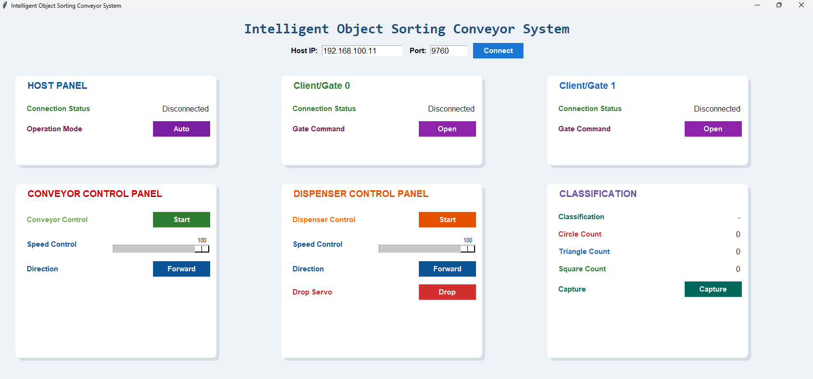
   </p>

9. The GUI provides control panels for:
   - Host panel: Shows connection status and allows switching between Auto/Manual modes
   - Client/Gate 0 and 1: Shows Client connection status and allows manual gate open/close control
   - Conveyor Control panel: Starts/Stops conveyor, adjusts speed (0-100%), and sets direction (Forward/Reverse)
   - Dispenser Control panel: Starts/Stops dispenser, adjusts speed, sets direction, and triggers object drop
   - Classification panel: Shows ML classification results, object counts (Circle, Triangle, and Square), and Capture control

10. The system operates in two modes:
   - Auto mode: Click the **Auto** button in the Host panel. Then, click **Capture** to start automatic sorting. The host automatically captures images, classifies objects using ML inference, controls the appropriate sorting gate, and moves objects along the conveyor.
   - Manual mode: Click the **Manual** button in the Host panel. Manually controls individual components (conveyor, dispenser, and gates) and triggers ML inference using the **Capture** button.

11. In Auto mode, the sorting logic operates as follows:
   - Circle objects: Sorted to Gate 0 (Client 0)
   - Triangle objects: Sorted to Gate 1 (Client 1)
   - Square objects: Continue to the end of the conveyor
   - Unknown objects: Reversed back on the conveyor

12. The Classification panel displays real-time counts for each object type as they are sorted.

## Conclusion

This demonstration shows how the Host node operates as the central controller within the 10BASE-T1S multi-node embedded network for an intelligent object sorting conveyor system. Using the PIC32CZ CA70 Curiosity Ultra Development Board, the host performs real-time object classification using machine learning, coordinates motor control for the conveyor and dispenser, and communicates with Client nodes to operate sorting gates.

The demo highlights the coordinated system operation where the host captures images, classifies objects, sends gate commands to Client nodes, and monitors gate status and object counts for system-wide control.

Overall, this setup illustrates a scalable and connected object sorting solution that combines edge-based ML inference, deterministic T1S communication, and centralized control in a compact embedded system architecture.
