# Mechanical Assembly - Intelligent Object Sorting Conveyor System

This guide describes how to assemble the object-sorting conveyor system. For electronics wiring, firmware, and the demo, refer to the demo [README](../README.md).

  <b>Figure 1.</b> Assembled System (3D View) 
  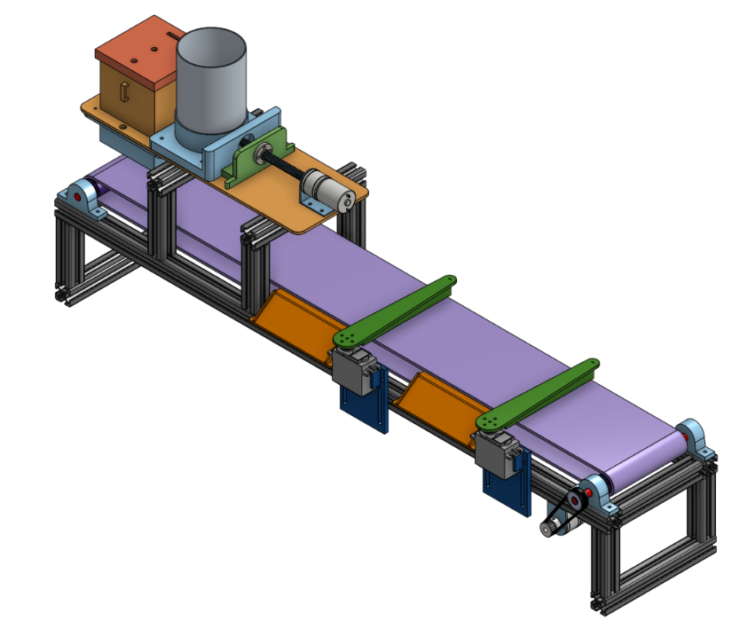

  <b>Figure 2.</b> Mechanical Drawing (Front, Side and Top Views) 
  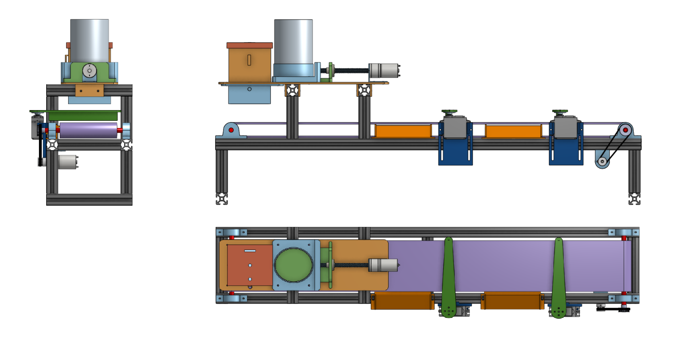

The assembly has three parts:
- Conveyor: aluminium-extrusion frame, two roller shafts in pillow-block bearings, and a belt driven by a DC motor.
- Sorting gates: two sorting ramps, each with a servo-driven arm.
- Dispenser: holds the objects in a tube. A DC motor and lead screw push the objects out of the tube one at a time, and a servo drops each object onto the belt.

## Hardware Needed

**Mechanical Parts**

Parts marked `3D-printed` are printed from the STL files in the [`parts`](parts) folder.

| Qty | Item | Source | STL File | Step | Used for |
|:---:|------|:------:|----------|:----:|----------|
| 2 | 20 x 20 mm T-slot extrusion, 750 mm | Purchased |  | 1 | Base frame, long side rails |
| 2 | 20 x 20 mm T-slot extrusion, 100 mm | Purchased |  | 1 | Base frame, end cross members |
| 1 | 20 x 20 mm T-slot extrusion, 100 mm | Purchased |  | 1 | Base frame, middle cross member |
| 4 | 20 x 20 mm T-slot extrusion, 100 mm | Purchased |  | 2 | Legs, 2 at each end |
| 2 | 20 x 20 mm T-slot extrusion, 100 mm | Purchased |  | 2 | Leg cross members, one at the bottom of each end |
| 4 | 8 mm bore inner ball-mounted (pillow-block) bearing | Purchased |  | 3 | Roller shaft support |
| 1 | 8 mm diameter smooth rod, 120 mm long | Purchased |  | 4 | Roller shaft, idler side |
| 1 | 8 mm diameter smooth rod, 150 mm long | Purchased |  | 4 | Roller shaft, motor end |
| 2 | Roller | 3D-printed | [`conveyor_roller.stl`](parts/conveyor_roller.stl) | 5 | Conveyor drive and idler rollers |
| 1 | Conveyor belt | Purchased |  | 6 | Object transport |
| 2 | Sorting ramp | 3D-printed | [`object_slider.stl`](parts/object_slider.stl) | 7 | Sorting gates |
| 2 | Servo mounting plate | 3D-printed | [`servo_mount.stl`](parts/servo_mount.stl) | 8 | Sorting gates |
| 2 | TowerPro MG995 plastic-gear servo motor, with horn | Purchased |  | 9, 10 | Gate servos |
| 2 | Gate arm | 3D-printed | [`object_slider_arm.stl`](parts/object_slider_arm.stl) | 11 | Sorting gates |
| 1 | TowerPro SG90 servo motor | Purchased |  | 23 | Drop servo |
| 1 | 16-tooth, 4 mm bore timing pulley | Purchased |  | 12 | Conveyor motor shaft |
| 1 | 40-tooth, 8 mm bore timing pulley | Purchased |  | 13 | Conveyor roller shaft |
| 1 | Timing belt, 158 mm long, 6 mm wide | Purchased |  | 13 | Conveyor drive |
| 1 | DC motor | Purchased |  | 12 | Conveyor drive |
| 1 | DC motor | Purchased |  | 19 | Dispenser drive |
| 2 | Motor bracket | Purchased |  | 12, 19 | One for the conveyor motor (step 12) and one for the dispenser motor (step 19) |
| 4 | 20 x 20 mm T-slot extrusion, 100 mm | Purchased |  | 14 | Dispenser legs, 2 per leg set |
| 2 | 20 x 20 mm T-slot extrusion, 100 mm | Purchased |  | 14 | Dispenser leg cross members, 1 per leg set |
| 1 | Dispenser base (with classification box) | 3D-printed | [`dispenser_base.stl`](parts/dispenser_base.stl) | 15 | Object dispenser |
| 1 | Classification box lid | 3D-printed | [`camera_cover.stl`](parts/camera_cover.stl) | 16 | Object dispenser |
| 1 | Feeder housing | 3D-printed | [`dispenser.stl`](parts/dispenser.stl) | 17 | Object dispenser |
| 1 | Object pusher | 3D-printed | [`dispensor_slider.stl`](parts/dispensor_slider.stl) | 18 | Object dispenser |
| 1 | 150 mm trapezoidal lead screw, 8 mm, 4-start | Purchased |  | 20 | Dispenser feed |
| 1 | Aluminium flexible coupling, 5 x 8 mm | Purchased |  | 20 | Dispenser motor shaft (5 mm) to lead screw (8 mm) |
| 1 | Cylinder tube | 3D-printed | [`dispenser_tube.stl`](parts/dispenser_tube.stl) | 21 | Object dispenser |
| 1 | Object dropper mechanism | 3D-printed | [`twister_base.stl`](parts/twister_base.stl) | 22 | Object drop |
| 1 | Object dropper | 3D-printed | [`twister.stl`](parts/twister.stl) | 23 | Object drop |

Total extrusion: 17 profiles (2 x 750 mm and 15 x 100 mm). Add the matching T-nuts, corner brackets, and bolts for the extrusion profile used.

## Before Starting

Tools: hex keys for the bolts and T-nuts, a screwdriver, a tape measure or ruler, a square, a saw (or a supplier cutting service) for the extrusions and rods, and a soldering iron for the motor and servo wires.

3D-printed parts: Print the parts with an STL file listed in the table under [Hardware Needed](#hardware-needed) and remove all support material. Test-fit each part on the matching rod, bolt, or servo before use. The two sorting gates are identical, so print the ramp, servo plate, and gate arm twice (steps 7, 8, and 11). The two rollers (step 5) use the same model.

Build order: conveyor frame (steps 1-6), sorting gates (steps 7-11), conveyor drive (steps 12-13), then dispenser (steps 14-23). Finish and check each stage before starting the next.

General tips:
- Keep the frame square at every extrusion joint. Tighten the corner bolts only after checking each joint with a square.
- Leave the bolts that hold bearings and motors slightly loose until the belts are fitted, then tighten the bolts.
- Do not connect the power during assembly. Do the wiring in the demo [README](../README.md#hardware-setup) after the frame is complete.

## Assembly Steps

Each step names the printed part (if any) and gives a check to complete before continuing.

### Conveyor Frame

#### Step 1: Base Frame

Join the two 750 mm rails and the 100 mm cross members into a rectangle, with one cross member at each end and one in the middle. Use corner brackets and T-nuts.

- Check: The frame sits flat without rocking and the diagonals are equal in length

   
<b>Figure 3.</b> Step 1 - Base Frame 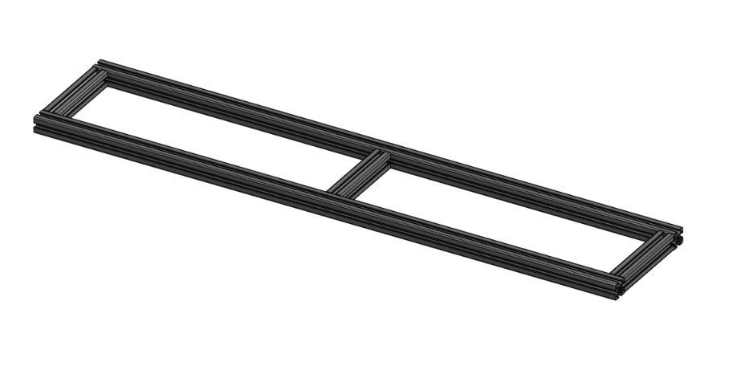

#### Step 2: Legs

Fit the four 100 mm legs, two at each end, to raise the frame. Join each pair of legs with a 100 mm cross member at the bottom.

- Check: The frame stands level and does not wobble

   
<b>Figure 4.</b> Step 2 - Legs 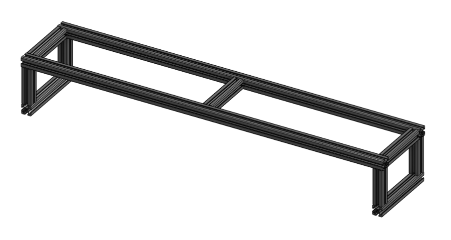

#### Step 3: Bearings

Bolt the four pillow-block bearings to the frame, two at each end (highlighted). Leave the bolts slightly loose so the bearings can be aligned.

- Check: Each bearing lines up with the opposite bearing

   
<b>Figure 5.</b> Step 3 - Bearings 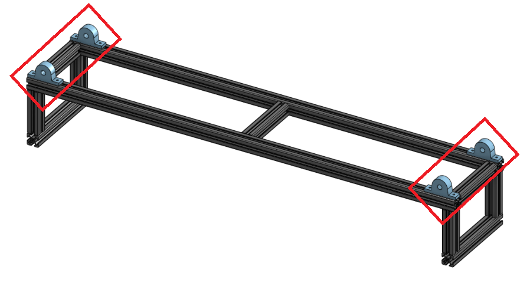

#### Step 4: Shafts

Pass an 8 mm shaft through each bearing pair (arrows). Use the 120 mm shaft at the idler side and the 150 mm shaft on the motor end.

- Check: Both shafts spin freely and sit parallel to each other

   
<b>Figure 6.</b> Step 4 - Shafts 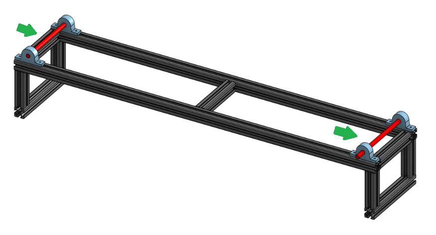

#### Step 5: Rollers

Fit a roller on each shaft and fix the roller in place. The shaft end that sticks out at the right is the drive end for the motor.

- Printed part: [`conveyor_roller.stl`](parts/conveyor_roller.stl)
- Check: The rollers turn with the shaft and do not wobble

   
<b>Figure 7.</b> Step 5 - Rollers 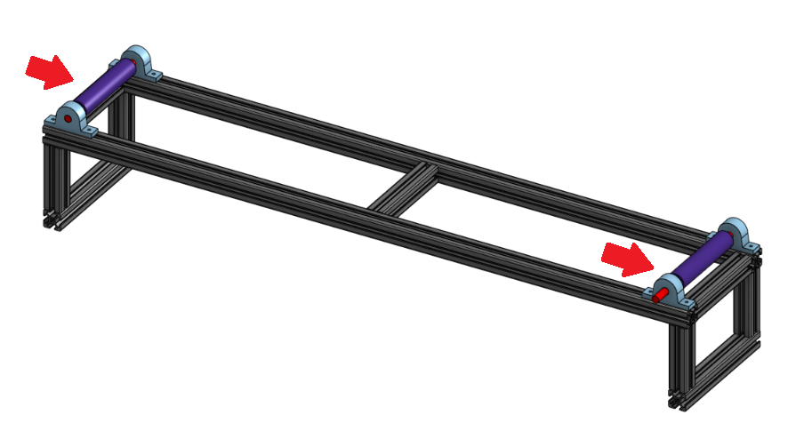

#### Step 6: Belt

Fit the belt around both rollers. Move the bearings along the frame to tension the belt, then tighten the bearing bolts.

- Check: The belt runs centered on the rollers when a roller is turned by hand

   
<b>Figure 8.</b> Step 6 - Belt 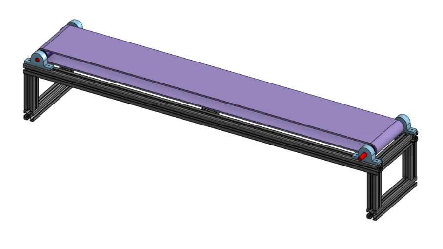

### Sorting Gates

#### Step 7: Sorting Ramps

Mount the two sorting ramps (orange) on the side of the frame alongside the belt. Leave a small gap between each ramp and the belt to prevent rubbing.

- Printed part: [`object_slider.stl`](parts/object_slider.stl)
- Check: Both ramps are at the same height and the belt turns freely

   
<b>Figure 9.</b> Step 7 - Sorting Ramps 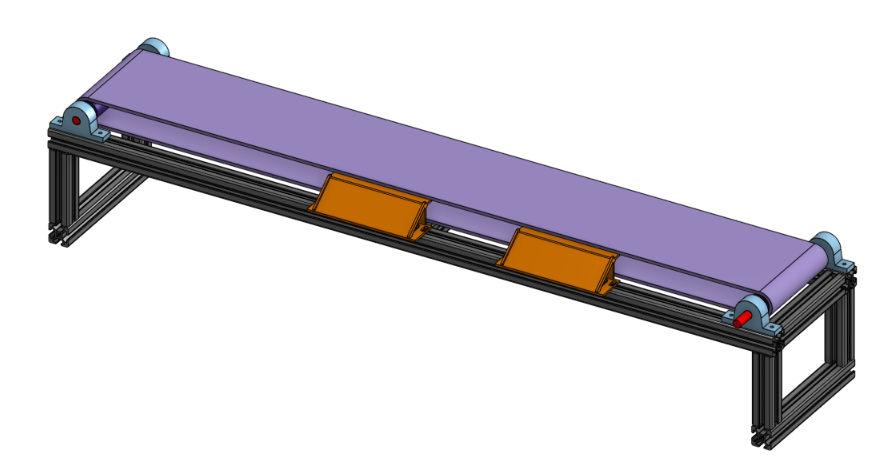

#### Step 8: Servo Mounting Plates

Attach the two servo mounting plates (dark blue) to the frame next to each ramp.

- Printed part: [`servo_mount.stl`](parts/servo_mount.stl)
- Check: The servo mounting plates are fixed firmly to the frame, level with the ramps

   
<b>Figure 10.</b> Step 8 - Servo Mounting Plates 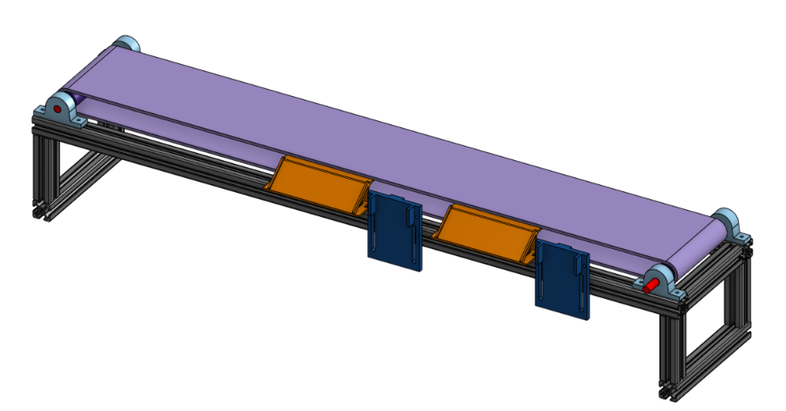

#### Step 9: Servos

Mount a servo on each plate.

- Check: Each servo is held firmly and cannot move on the plate

   
<b>Figure 11.</b> Step 9 - Servos 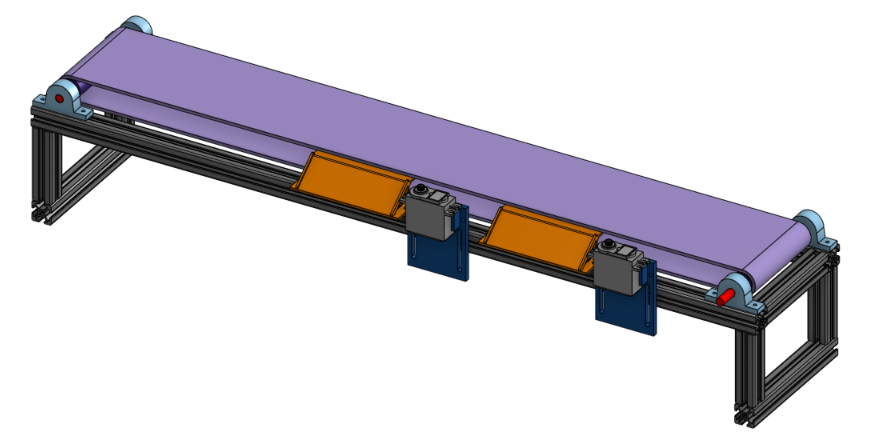

#### Step 10: Servo Horns

Fit a servo horn on each servo shaft (highlighted). Centre each servo (for example, using a servo tester) before fitting the horn.

- Check: Each horn is fixed firmly on the servo shaft

   
<b>Figure 12.</b> Step 10 - Servo Horns 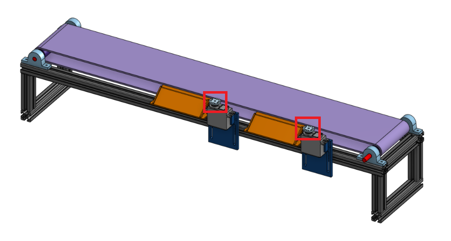

#### Step 11: Gate Arms

Fasten a gate arm (green) to each horn. Centre the servo before fixing the arm, so the arm sits across the belt as the gate rest position

- Printed part: [`object_slider_arm.stl`](parts/object_slider_arm.stl)
- Check: The arm moves without touching the belt or the ramp

   
<b>Figure 13.</b> Step 11 - Gate Arms 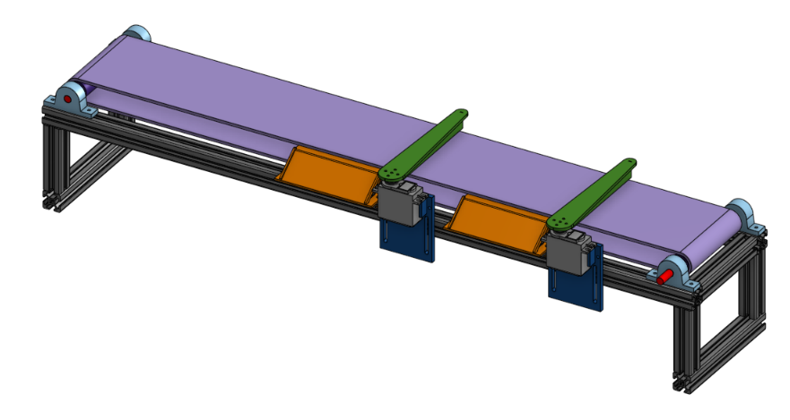

### Conveyor Drive

#### Step 12: Conveyor Motor

Fit the 16-tooth pulley on the motor shaft, then fit the conveyor DC motor in a motor bracket and mount the bracket below the frame at the drive end (highlighted). Leave the mounting bolts slightly loose.

- Check: The motor shaft is parallel to the roller shaft, and the pulley is secure on the motor shaft

   
<b>Figure 14.</b> Step 12 - Conveyor Motor 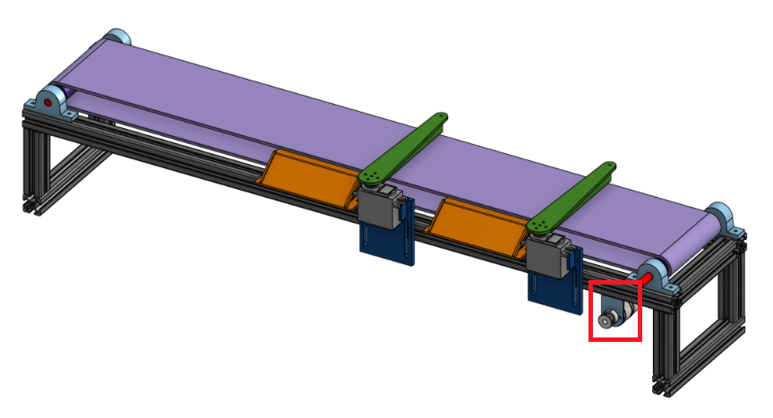

#### Step 13: Drive Belt

Fit the 40-tooth pulley on the roller shaft, then put the 158 mm timing belt around both. Slide the motor away from the roller until the belt is tight, then tighten the motor bolts.

- Check: The pulleys are aligned, and turning the roller by hand turns the motor shaft smoothly

   
<b>Figure 15.</b> Step 13 - Drive Belt 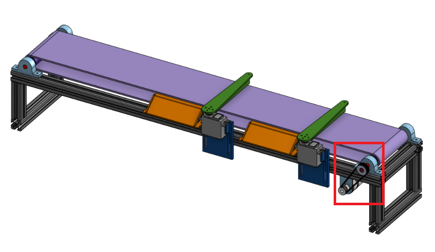

### Dispenser

#### Step 14: Dispenser Supports

Build the two dispenser leg sets (each two legs and a cross member) and fix the leg sets over the belt at the input end, to support the dispenser base.

- Check: Both leg sets are vertical and the same height, with room below the base for the belt

   
<b>Figure 16.</b> Step 14 - Dispenser Supports 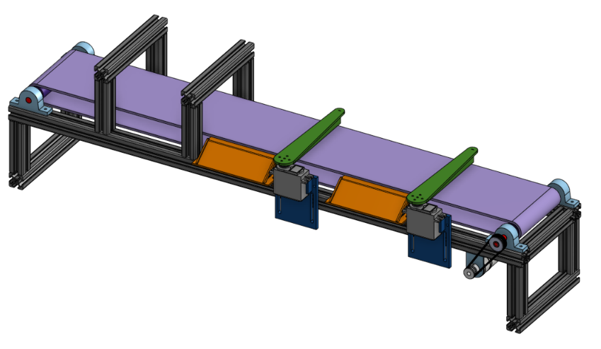

#### Step 15: Dispenser Base

Mount the dispenser base on the dispenser legs. The classification box is part of the base and sits at the left end.

- Printed part: [`dispenser_base.stl`](parts/dispenser_base.stl)
- Check: The dispenser base is level and fixed firmly on the dispenser legs

   
<b>Figure 17.</b> Step 15 - Dispenser Base 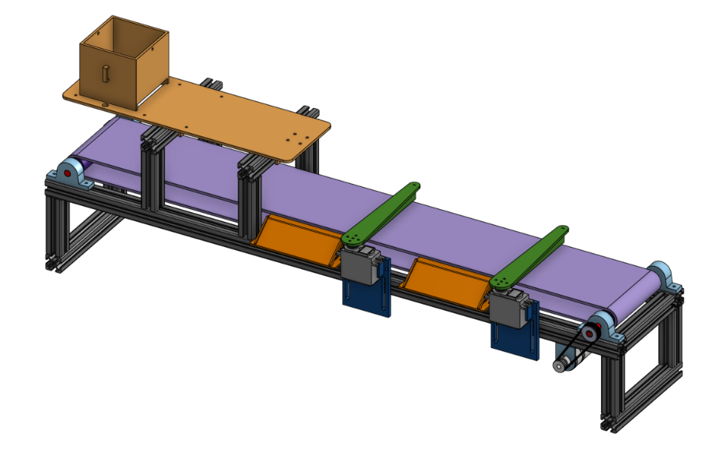

#### Step 16: Classification Box Lid

Fit the lid on the classification box.

- Printed part: [`camera_cover.stl`](parts/camera_cover.stl)
- Check: The lid sits flat on the classification box

   
<b>Figure 18.</b> Step 16 - Classification Box Lid 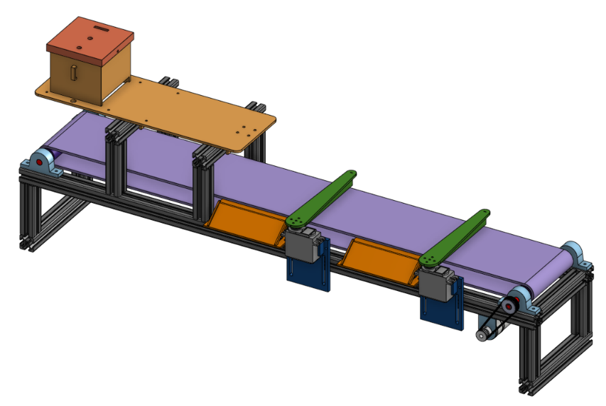

#### Step 17: Feeder Housing

Mount the feeder housing (light blue) on the base next to the classification box.

- Printed part: [`dispenser.stl`](parts/dispenser.stl)
- Check: The feeder housing is fixed firmly on the base

   
<b>Figure 19.</b> Step 17 - Feeder Housing 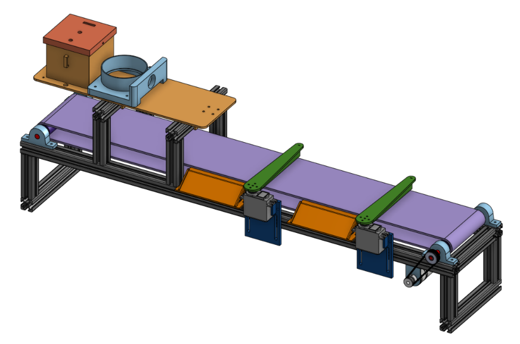

#### Step 18: Object Pusher

Mount the object pusher (green) on the base, aligned with the feeder housing.

- Printed part: [`dispensor_slider.stl`](parts/dispensor_slider.stl)
- Check: The object pusher and the feeder housing are on the same centre line

   
<b>Figure 20.</b> Step 18 - Object Pusher 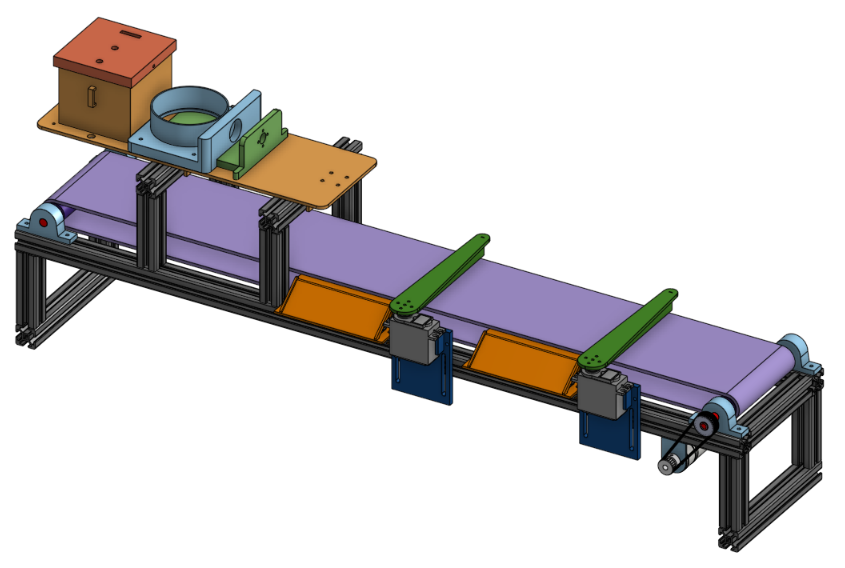

#### Step 19: Dispenser Motor

Fit the dispenser DC motor in a motor bracket and mount the bracket at the far end of the base. Leave the bolts slightly loose until the lead screw is fitted.

- Check: The motor shaft is aligned with the lead screw position

   
<b>Figure 21.</b> Step 19 - Dispenser Motor 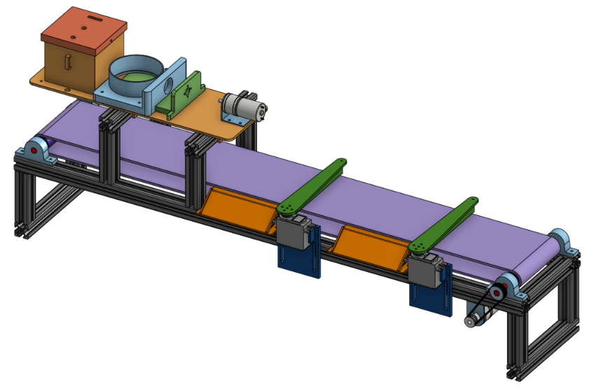

#### Step 20: Lead Screw

Couple the motor shaft (5 mm) to the 150 mm lead screw (8 mm) using the flexible coupling. Pass the lead screw through the object pusher toward the feeder. Then tighten the motor bolts.

- Check: The lead screw turns by hand without binding

   
<b>Figure 22.</b> Step 20 - Lead Screw 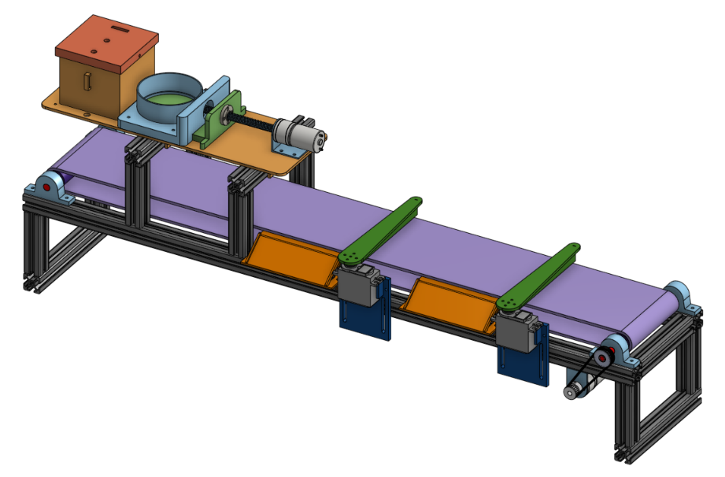

#### Step 21: Cylinder Tube

Place the cylinder tube in the feeder housing. The build shown in Figure 1 is now complete.

- Printed part: [`dispenser_tube.stl`](parts/dispenser_tube.stl)
- Check: The cylinder tube moves freely in the housing

   
<b>Figure 23.</b> Step 21 - Cylinder Tube 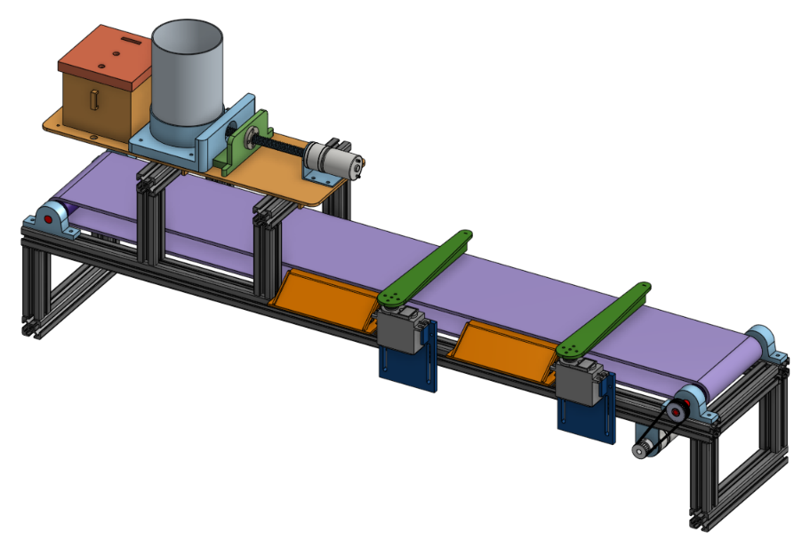

### Drop Mechanism (Bottom View)

#### Step 22: Object Dropper Mechanism

Fit the object dropper mechanism onto the classification box. The view is from above, with the cylinder tube below the base.

- Printed part: [`twister_base.stl`](parts/twister_base.stl)
- Check: The object dropper mechanism sits flat on the classification box

   
<b>Figure 24.</b> Step 22 - Object Dropper Mechanism 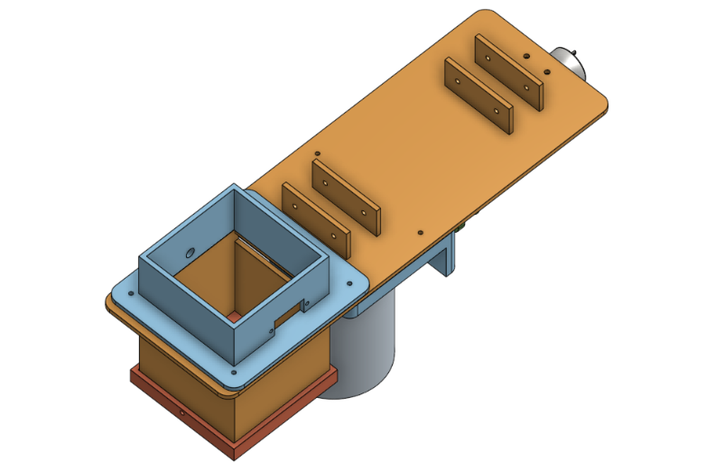

#### Step 23: Object Dropper

Fit the object dropper into the object dropper mechanism and attach the TowerPro SG90 servo and horn at the highlighted location.

- Printed part: [`twister.stl`](parts/twister.stl)
- Check: The object dropper is seated fully in the object dropper mechanism and moves freely

   
<b>Figure 25.</b> Step 23 - Object Dropper 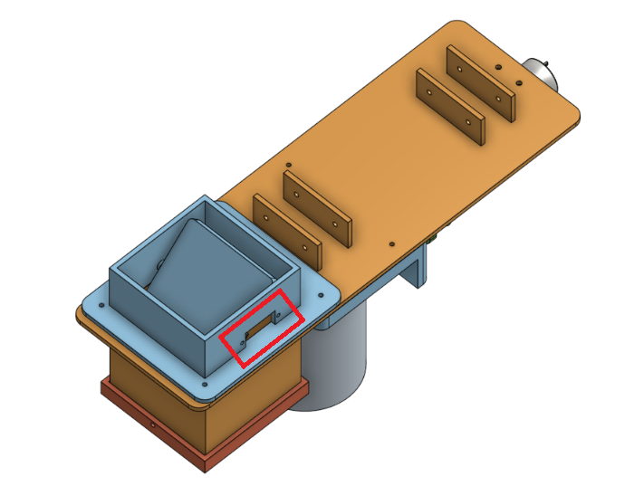

### Final Checks

- Tighten all bolts, then turn both rollers, and the lead screw by hand once more
- Check that the gate arms, belt, and cylinder tube move freely without catching
- Route all cables away from the belt, rollers and lead screw

## After Assembly

Wire the motors, servos, and limit switch as described in the Hardware Setup section of the demo [README](../README.md#hardware-setup).
